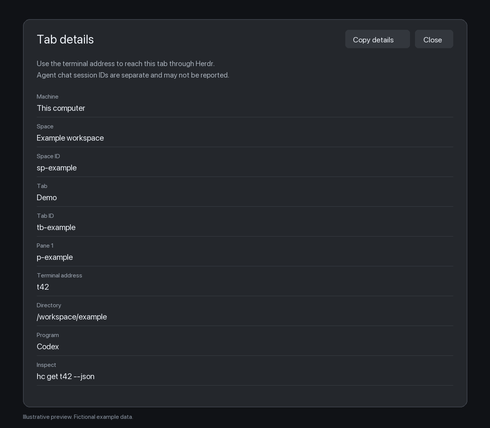

# Herdr Tab details

Inspect and copy a tab's terminal addresses, pane IDs, directories, and agent
reports from the Herdr desktop command palette.



The preview is an illustration with fictional data, not a captured session.

## Why

Tab names do not tell another agent which terminal to address. Tab details
puts the relevant identifiers and read-only CLI commands in one copyable panel.

## What

- Open **Tab details** from **Command+Shift+P**.
- Inspect every pane in the selected tab, including remote terminal addresses.
- Copy fresh metadata with **Copy details**. A closed tab cannot copy stale data.
- Keep the existing command palette entries alongside the new command.

## Quick start

Tested with **Herdr.app 0.1.13 on macOS**. The installer needs **Node.js 22+**;
the installed mods do not need Node, npm packages, or a background process.

Clone the public repository and run the installer:

```sh
git clone https://github.com/ceaksan/herdr-tab-details.git
cd herdr-tab-details
node install.mjs
```

Select a tab, press **Command+Shift+P**, type **Tab details**, and press Enter.
The panel keeps the tab selected at opening. Close it with Escape or **Close**.

The installer reads the existing Herdr desktop `keys.json`, copies the two mods,
and merges the palette shortcut. Start Herdr once before installing so that its
configuration exists. Changes apply live.

## Installation options

| Option | Purpose |
| --- | --- |
| `--app-home PATH` | Use an explicit Herdr desktop configuration directory. |
| `HERDR_APP_HOME` | Use the app's environment-selected configuration directory. |
| `XDG_CONFIG_HOME` | Use its `herdr-app` subdirectory when no app home is selected. |
| `--home HOME` | Override the home used for the default `.config/herdr-app` path. |
| `--replace` | Replace reviewed, differing mod files after making backups. |

Explicit `--app-home` takes priority over environment variables. By default,
different existing mod files or a custom palette shortcut stop installation
before files are changed. Unchanged files are left alone; changed existing files
receive timestamped `.bak` backups. Installation is not transactional across files.

For an agent-assisted installation, read [RECIPE.md](RECIPE.md), copy the two
folders under `mods/` into the app's mods directory, and merge [keys.json](keys.json)
into the existing key file. Do not replace the entire key file with the snippet.

## Privacy and limits

The details panel reads Herdr's in-memory tab and terminal metadata. It does not
read conversation files, run shell commands, send messages, or make network requests.
**Copy details** writes only to the local clipboard when clicked. Copied details
include directory paths, IDs, titles, and any agent report, so review them before
sharing. The bundled palette still runs the Herdr action the user selects.

Terminal addresses are separate from agent chat session IDs. Missing reports
are shown as **Not reported by Herdr**. Remote addresses keep their machine prefix.

The bundled palette is based on Herdr.app 0.1.13; future palette changes require
reconciliation. The app menu can still open the stock palette. Editing
`keys.json` makes it user-owned, so new upstream default bindings need manual merging.
Other Herdr versions and operating systems have not been verified.

## Remove or reinstall

Restore the previous Command+Shift+P binding from the key-file backup, or set it
to `app.palette` if that was its original value. Remove only the installed
`herdr-info` and `herdr-info-palette` mod folders after preserving any changes.

For a migration from another installation, first save its two mod folders and
the current key file outside this checkout. Install the downloaded release and
verify it before removing the saved copy. No runtime path points back to the checkout.

## Development

```sh
node --experimental-vm-modules --test info.test.mjs
herdr-app check ./mods/herdr-info
herdr-app check ./mods/herdr-info-palette
gitleaks dir . --redact --no-banner
```

Tests exercise the actual mod entry points with native host modules mocked and
run the installer against temporary configuration folders. Native checks validate
host APIs; opening the panel in Herdr is also required for visual validation.
Herdr-generated declarations and local configuration are ignored by Git.

## Upstream code

The adapted palette and bundled icon come from Herdr.app under Apache 2.0.
See [THIRD_PARTY_NOTICES.md](THIRD_PARTY_NOTICES.md) and the included upstream license.

## License

[Apache License 2.0](LICENSE).
