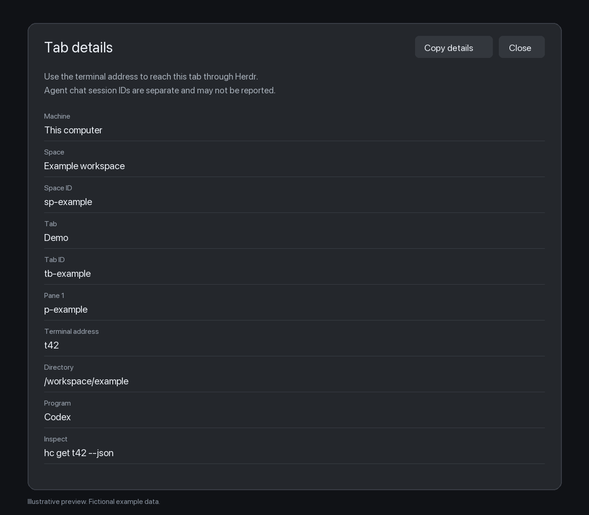

# Tab details

A native Herdr desktop panel showing the identifiers needed to inspect a tab
or hand its terminal address to another agent. Open Command+Shift+P and select
Tab details. The bundled palette keeps the normal Herdr commands.

The preview uses fictional data and is illustrative, not a session screenshot.

## What you see

A centered dialog, 850 logical pixels wide and 80 percent of the window height,
uses the active Herdr theme's popover background and foreground text. Inside,
22 pixels of padding surround a vertical stack with 16-pixel gaps. The header
has a 19-pixel semibold title, Copy details, and Close. Body text is 13 pixels.

A short hint distinguishes terminal addresses from chat session IDs. Below is
a scrolling list of 11-pixel muted labels and values, separated by theme borders:
machine, space name/ID, tab name/ID, then each pane's ID, terminal address, title,
directory, program, agent, status, report, and read-only CLI commands.
Mod-only panes show their mod name instead of terminal fields.

The command palette is 640 pixels wide. It has a search input, grouped rows,
recent selections, keyboard navigation, and a Tab details entry.

## How it behaves

Opening captures the selected tab. Metadata stays live, but later tab focus
changes do not retarget the panel. A missing or disconnected tab shows an error
and removes the copy button. Copy details obtains fresh values, writes to the
local clipboard, and changes the button label to Copied. Close and Escape dismiss.

Working, blocked, done, and idle are shown as reported text, without special
status colors. Unreported fields say Not reported by Herdr. No status is inferred
from the title. Multiple panes and remote machine prefixes remain distinct.

The palette supports typing, arrow keys, page navigation, Enter, row clicks,
and Escape. Selection closes the palette and opens the information dialog.

## Built from

Two folders, `mods/herdr-info/` and `mods/herdr-info-palette/`, each contain
`main.js` and `mod.json`. The palette also contains `command.svg`.
The optional `keys.json` is a merge snippet binding Command+Shift+P to
`mod.open:herdr-info-palette`.

The panel uses gpui-kit View/div and gpui-base flex containers. It reads
`spaces()`, `panes()`, `terminals()`, `focused()`, `props()`, and `theme()`.
It accepts an optional explicit tab ID through props. Native clipboard writes
use the current callback's context, never a retained context.

The palette reads available commands, layouts, keys and theme, uses native
InputState/Input, and dispatches user-selected actions through `run()`.
Recent command identifiers use localStorage. The panel stores no metadata.
Neither mod directly calls exec, hc, fetch, or a file API. CLI examples are text.

## Watch out

Tested on macOS with Herdr.app 0.1.13. This targets the desktop app API.
Do not edit the built-in frame, which Herdr rewrites. Preserve the other
keybindings when merging; ask before replacing a different custom shortcut.
If a mod name is taken, rename it and update references, asset paths and keys.

The palette is adapted upstream code; retain its notices and Apache 2.0 license.
Herdr metadata may not contain a chat session UUID. Do not invent one or inspect
conversation files to find it. Copied values can contain private local paths.

For Gallery publication, include these files, the recipe, and preview.png in a
public repository with topic `herdr-mod`. No layout file is needed.

## Done when

Both native mod checks pass. The palette displays Tab details and preserves
standard commands. Opening shows the selected tab's real identifiers.
Copy details matches current metadata. Changing focus does not retarget the
open panel. A closed target cannot copy stale metadata. Remote addresses keep
their prefix. Installation tests pass without altering unrelated settings.
